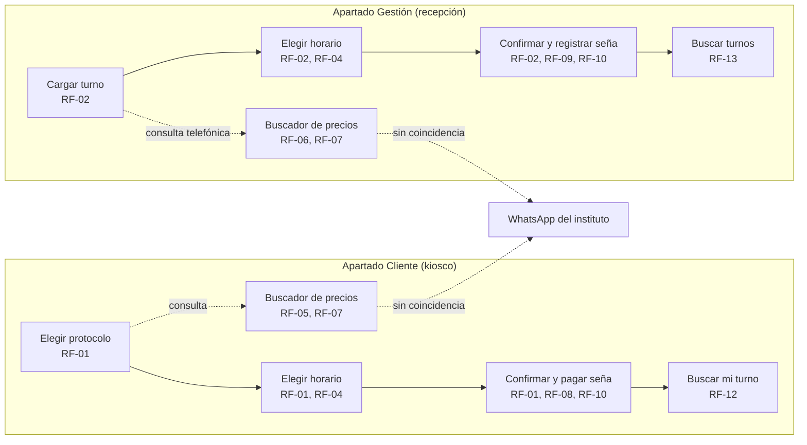

# Maquetado

El maquetado tuvo dos etapas. La primera (Semanas 5-6 reales) se hizo en
Figma como wireframes de una app móvil self-service remota (la paciente
reservaba desde su celular con un enlace mágico). La segunda (Semana 7
real, cierre) la reemplaza: la restricción técnica real del equipo es
sobre la **tecnología** (Qt, no HTML/web), no sobre quién puede usar el
sistema. Un self-service remoto desde el celular de la paciente sí
necesitaría web y se descarta, pero un self-service presencial en un
kiosco Qt dentro del instituto no. Esta versión, con los dos apartados,
es la vigente.

## Los dos apartados

- **Apartado Cliente**: pantalla táctil (kiosco) instalada en Dermalia,
  para que la paciente cargue su propio turno, consulte precios y busque
  su turno mientras está en el local.
- **Apartado Gestión**: lo usa la recepción desde la PC del mostrador,
  para cargar turnos que llegan por teléfono, administrar la
  disponibilidad y resolver consultas telefónicas con el mismo buscador.

Los dos comparten los Componentes R1-R4 de la MML y la misma base en SQL
Server (`docs/03-matriz-marco-logico.md`); el detalle de RF por apartado
está en `docs/04-requerimientos.md`.

## Mockup de escritorio (Qt)

Mockup interactivo con las pantallas de los dos apartados, navegables
desde un selector superior (Cliente / Gestión) y un panel lateral con las
pantallas de cada uno:
https://claude.ai/artifact/LAL3dVf5JWdd3SD7VYuRFX

Pensado como referencia visual para construir la interfaz real en Qt
Designer / Qt Widgets (el apartado Cliente en una ventana táctil vertical,
el apartado Gestión en una ventana de escritorio horizontal), no como el
diseño final pixel a pixel.

## User flow

La paciente entra por el kiosco cuando está en el instituto; la recepción
entra por su PC cuando la paciente llama. Ambos caminos terminan en el
mismo dato: un turno con seña registrada y recordatorio, buscable después
desde cualquiera de los dos apartados según quién lo necesite ver.

## Pantalla → RF cubiertos

**Apartado Cliente**

| Pantalla | RF cubiertos |
|---|---|
| 1, Elegir protocolo | RF-01, RF-04 |
| 2, Elegir horario | RF-01, RF-04 |
| 3, Confirmar turno y pagar seña | RF-01, RF-08, RF-10 |
| 4, Buscador de precios y protocolos | RF-05, RF-07 |
| 5, Buscar mi turno (DNI/teléfono) | RF-12, RF-11 (recordatorio) |

**Apartado Gestión**

| Pantalla | RF cubiertos |
|---|---|
| 1, Cargar turno | RF-02, RF-04 |
| 2, Elegir horario | RF-02, RF-04 |
| 3, Confirmar turno y registrar seña | RF-02, RF-09, RF-10 |
| 4, Buscador de precios y protocolos | RF-06, RF-07 |
| 5, Buscar turnos (nombre/DNI/teléfono) | RF-13, RF-11 (recordatorio) |

RF-03 (disponibilidad de los profesionales) no tiene pantalla propia
todavía: queda como panel de administración pendiente de diseñar, dentro
del apartado Gestión.

## Justificación de las decisiones de diseño

- Mismo flujo de 3 pasos en los dos apartados (protocolo → horario →
  confirmación): la paciente y la recepción entienden la misma secuencia,
  y el equipo solo mantiene una lógica de negocio, no dos.
- El kiosco (Cliente) usa controles más grandes y espaciados, pensados
  para pantalla táctil; la PC de recepción (Gestión) usa una densidad
  mayor, pensada para mouse y teclado y para repetir la carga muchas
  veces por día.
- La seña tiene su propia tarjeta en los dos apartados, separada del
  resumen del turno: la evidencia de `propuestas.md` dice que puede
  generar resistencia en la paciente, así que el monto y la regla (30%
  del valor del protocolo, mínimo $5.000, reembolsable con +24h, RF-10)
  quedan visibles antes de confirmar el pago simulado, en vez de aparecer
  como un cargo sorpresa.
- El buscador de precios y protocolos muestra de dónde sale cada
  resultado ("Base de precios y protocolos" o derivación a WhatsApp), en
  los dos apartados, para no prometer una respuesta que el sistema no
  puede resolver.
- "Buscar mi turno" (Cliente) y "Buscar turnos" (Gestión) no dependen de
  ningún enlace ni contraseña: alcanza con DNI o teléfono, porque en los
  dos casos hay alguien físicamente presente (la paciente en el kiosco,
  la recepción en el mostrador) verificando la identidad.

## Evaluación heurística (Nielsen)

| Heurística | Cómo se resuelve |
|---|---|
| 1. Visibilidad del estado del sistema | "Paso 1/2/3 de 3" en la carga de turno de los dos apartados; badge "Confirmado" al buscar un turno; el buscador de precios marca la fuente de cada resultado. |
| 2. Lenguaje del usuario | Sin jerga técnica: "Elegir horario", "Pagar seña" (Cliente) / "Registrar seña" (Gestión), nunca "slot" ni "booking". |
| 3. Control y libertad | Botón "Volver" en cada paso de la carga; "Cancelar turno" siempre visible en las búsquedas. |
| 4. Consistencia y estándares | Mismo color primario y tipografía en los dos apartados; el kiosco usa controles más grandes, pero la misma paleta y jerarquía visual. |
| 5. Prevención de errores | Solo se muestran horarios realmente disponibles (RF-04), no se puede cargar un turno sobre uno ya ocupado, en ningún apartado. |
| 6. Reconocer antes que recordar | El resumen antes de confirmar repite protocolo, fecha, hora y precio en los dos apartados. |
| 7. Flexibilidad y eficiencia | El buscador resuelve una consulta de precio en un resultado, sin pasar por los 3 pasos de carga de turno. |
| 8. Diseño estético y minimalista | Cada pantalla tiene una sola acción primaria; nada compite con ella. |
| 9. Ayudar a reconocer y recuperarse de errores | Cuando el buscador no encuentra coincidencia, lo dice explícitamente y ofrece derivar a WhatsApp, no un error genérico. |
| 10. Ayuda y documentación | Enlace "Ayuda" fijo en la barra superior de los dos apartados. |

## Preguntas para la coevaluación cruzada

1. ¿El mismo flujo de 3 pasos funciona igual de bien para una paciente
   tocando una pantalla en el kiosco que para la recepción usando mouse y
   teclado todo el día, o alguno de los dos necesita un diseño distinto?
2. El buscador deriva a WhatsApp cuando no encuentra coincidencia en los
   dos apartados, ¿alcanza con marcarlo en pantalla, o el kiosco (sin
   nadie de recepción cerca en ese momento) necesita un paso adicional?
3. Con la restricción de C + SQL Server + Qt sin APIs, la seña y el
   recordatorio quedaron mockeados en los dos apartados, ¿esa simulación
   se entiende con solo texto en pantalla, o hace falta una aclaración
   visual más explícita, sobre todo en el kiosco donde nadie de recepción
   está ahí para aclararlo en el momento?

## Qué falta

- Diseñar la pantalla de administración de disponibilidad (RF-03), que
  todavía no tiene wireframe propio.
- Coevaluación cruzada con otro equipo (estado general: ver README.md).

## Historial: maquetado móvil remoto en Figma (reemplazado)

Las 5 pantallas originales, pensadas como app móvil self-service remota
para la paciente (reserva desde el celular, con enlace mágico), quedan en
Figma como registro del primer intento:
https://www.figma.com/design/qEWMXwg68LQOtj9PzRnh1A/Untitled. Ya no
reflejan el modelo de uso actual (kiosco presencial + recepción, los dos
en Qt), así que no son la referencia vigente. Se dejan sin borrar porque
muestran el proceso de descarte, igual que las propuestas rechazadas en
`docs/propuestas.md`.
