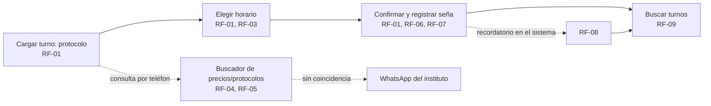

# Maquetado

El maquetado tuvo dos etapas. La primera (Semanas 5-6 reales) se hizo en
Figma como wireframes de una app móvil self-service para la paciente. La
segunda (Semana 7 real, cierre) la reemplaza: el equipo confirmó que el
sistema real es una herramienta de escritorio en Qt que opera la
recepción, no un self-service que la paciente usa desde su celular —
"Mis Turnos" con enlace mágico y el buscador como chat de cliente no son
compatibles con esa restricción técnica. Esta versión es la vigente.

## Por qué cambió el maquetado

Con backend en C + SQL Server y frontend en **Qt de escritorio, sin web ni
API externa** (`docs/04-requerimientos.md`), no hay forma de que la
paciente reserve desde su celular con un enlace mágico: eso requiere un
canal web que el equipo no tiene. El sistema pasó a ser una herramienta
interna: la recepción lo usa en la PC del instituto para cargar el turno
que la paciente pide por teléfono o en persona. Eso simplificó el diseño
en dos puntos:

- El buscador de precios y protocolos deja de simular un chat con la
  paciente y pasa a ser una búsqueda simple que usa la recepción para
  responder rápido por teléfono (RF-04).
- "Mis Turnos" con enlace mágico se reemplaza por una búsqueda de turnos
  por nombre, DNI o teléfono, que también usa la recepción (RF-09).

## Las 5 pantallas (versión Qt de escritorio)

Mockup interactivo, con las 5 pantallas navegables desde un panel lateral,
en formato de ventana de escritorio (barra de título, navegación lateral,
contenido): https://claude.ai/artifact/LAL3dVf5JWdd3SD7VYuRFX

Pensado como referencia visual para construir la interfaz real en Qt
Designer / Qt Widgets, no como el diseño final pixel a pixel.

## User flow

La recepción entra por "Cargar turno" cuando una paciente llama o se
acerca al mostrador (o por el buscador de precios/protocolos si la
consulta es solo informativa) y sale con un turno confirmado, que después
puede volver a encontrar en "Buscar turnos". El buscador es un camino
paralelo, no un paso obligatorio: puede resolver la consulta sola o
derivarla al WhatsApp del instituto sin cortar la carga de un turno.

## Pantalla → RF cubiertos

| Pantalla | RF / RNF cubiertos |
|---|---|
| 1, Cargar turno — elegir protocolo | RF-01, RF-03 |
| 2, Elegir horario | RF-01, RF-03 |
| 3, Confirmar turno y registrar seña | RF-01, RF-06, RF-07, RNF-04 |
| 4, Buscador de precios y protocolos | RF-04, RF-05, RNF-09 |
| 5, Buscar turnos (nombre/DNI/teléfono) | RF-09, RF-08 (recordatorio, visible en la tarjeta del turno) |

RF-02 (disponibilidad de los profesionales) no tiene pantalla propia en
este maquetado: queda como panel de administración pendiente de diseñar,
con una interfaz distinta de la que usa la recepción para cargar turnos.

## Justificación de las decisiones de diseño

- 3 pasos separados (protocolo → horario → confirmación) en vez de un solo
  formulario largo: reduce errores de carga y deja avanzar solo cuando el
  paso anterior está resuelto, atacando directamente C1/C2 del Árbol de
  Problemas (decisiones a medias por WhatsApp, sin estructura).
- La seña tiene su propia tarjeta, separada del resumen del turno, no es un
  campo más: la evidencia de `propuestas.md` dice que puede generar
  resistencia en la paciente, así que el monto y la regla (30% del valor
  del protocolo, mínimo $5.000, reembolsable si se cancela con más de 24 h
  de anticipación, RF-07) quedan visibles antes de que la recepción marque
  el pago como registrado, en vez de aparecer como un dato suelto.
- El buscador de precios y protocolos muestra de dónde sale cada resultado
  ("Base de precios y protocolos" o derivación a WhatsApp), así la
  recepción distingue una respuesta confiable de una que necesita escalar,
  sin prometerle a la paciente algo que el sistema no puede resolver.
- "Buscar turnos" no depende de que la paciente tenga ningún enlace ni
  contraseña: la recepción encuentra el turno con un dato que ya tiene
  a mano en cualquier llamada (nombre, DNI o teléfono), coherente con que
  el sistema es una herramienta interna, no un self-service.

## Evaluación heurística (Nielsen)

| Heurística | Cómo se resuelve |
|---|---|
| 1. Visibilidad del estado del sistema | "Paso 1/2/3 de 3" en el header de carga de turno; badge "Confirmado" en la búsqueda de turnos; el buscador de precios marca la fuente de cada resultado. |
| 2. Lenguaje del usuario | Sin jerga técnica: "Elegir horario", "Registrar seña", nunca "slot" ni "booking". |
| 3. Control y libertad | Botón "Volver" en cada paso de la carga; botón "Cancelar turno" siempre visible en la búsqueda. |
| 4. Consistencia y estándares | Un solo color primario (rosa) para toda acción principal, en las 5 pantallas; misma tipografía y radios de borde, más el marco de ventana de escritorio compartido (barra de título + nav lateral). |
| 5. Prevención de errores | Solo se muestran horarios realmente disponibles (RF-03), no se puede cargar un turno sobre uno ya ocupado. |
| 6. Reconocer antes que recordar | El resumen de la Pantalla 3 repite protocolo, fecha, hora y precio; la recepción no tiene que recordar lo que cargó antes. |
| 7. Flexibilidad y eficiencia | El buscador resuelve una consulta de precio o protocolo en un resultado, sin pasar por los 3 pasos de carga de turno. |
| 8. Diseño estético y minimalista | Cada pantalla tiene una sola acción primaria; nada compite con ella. |
| 9. Ayudar a reconocer y recuperarse de errores | Cuando el buscador no encuentra coincidencia, lo dice explícitamente y ofrece derivar a WhatsApp, no un error genérico. |
| 10. Ayuda y documentación | Enlace "Ayuda" fijo en la barra de título de las 5 pantallas. |

## Preguntas para la coevaluación cruzada

1. Al pasar de self-service (paciente) a herramienta interna (recepción),
   ¿el flujo de 3 pasos sigue siendo el orden más rápido para cargar un
   turno mientras se atiende una llamada, o convendría un formulario más
   corto pensado para uso repetido todo el día?
2. El buscador deriva a WhatsApp cuando no encuentra coincidencia, ¿alcanza
   con marcarlo en pantalla, o hace falta que la recepción pueda anotar
   directamente la consulta nueva para sumarla a la base?
3. Con la restricción de C + SQL Server + Qt sin APIs, la seña y el
   recordatorio quedaron mockeados (no hay pago ni envío reales), ¿esa
   simulación se entiende con solo texto en la pantalla, o hace falta una
   aclaración visual más explícita para que no parezca una promesa real?

## Qué falta

- Pasar el maquetado por la coevaluación cruzada con otro equipo antes de
  darlo por cerrado (Semana 7 real, última semana del bimestre del
  equipo).
- Diseñar la pantalla de administración de disponibilidad (RF-02), que
  todavía no tiene wireframe propio.

## Historial: maquetado móvil en Figma (reemplazado)

Las 5 pantallas originales, en formato de app móvil self-service para la
paciente, quedan en Figma como registro del primer intento:
https://www.figma.com/design/qEWMXwg68LQOtj9PzRnh1A/Untitled. Ya no
reflejan el modelo de uso actual (herramienta interna de recepción), así
que no son la referencia vigente — ver "Por qué cambió el maquetado" más
arriba. Se dejan sin borrar porque muestran el proceso de descarte, igual
que las propuestas rechazadas en `docs/propuestas.md`.
